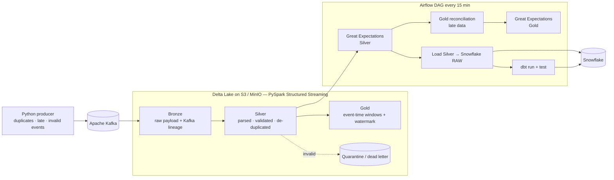
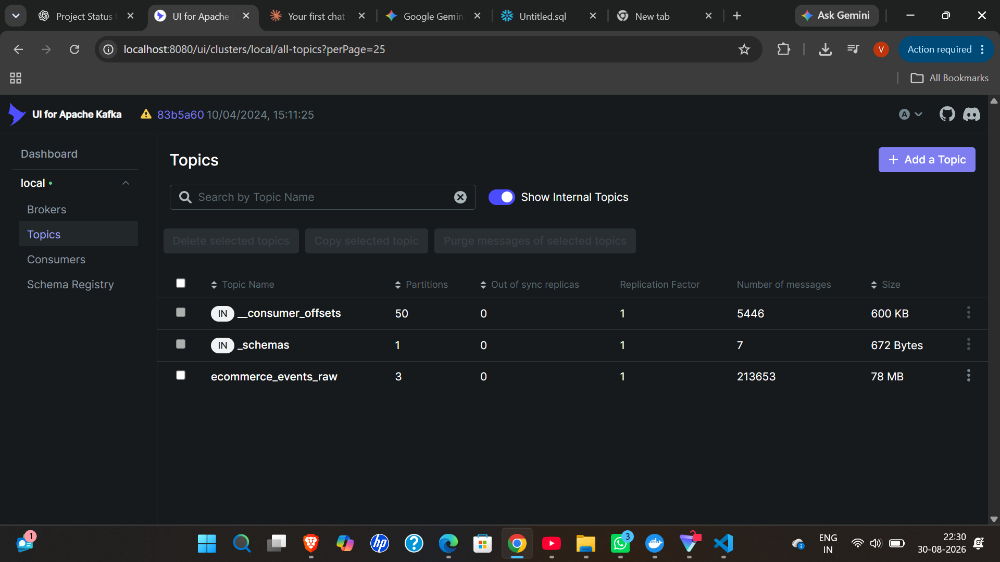
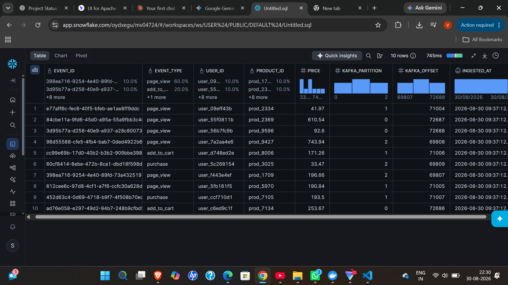
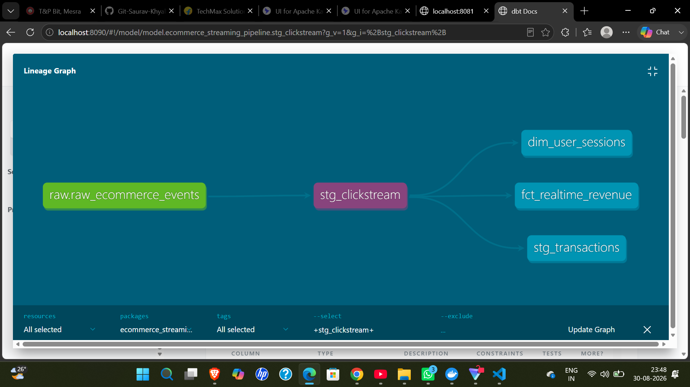

# Real-Time E-Commerce Data Engineering Platform


**Python · Apache Kafka · PySpark Structured Streaming · AWS S3 (MinIO locally) · Delta Lake · Snowflake · dbt · Airflow · Great Expectations · Docker**

An end-to-end streaming data platform for e-commerce clickstream, order and
transaction events. Events flow through a Bronze → Silver → Gold medallion
lakehouse on Delta Lake, are validated by Great Expectations, orchestrated by
Airflow, and modelled into dimensional tables and marts in Snowflake with dbt.



## Quick start (one command, nothing to simulate)

Requires Docker Desktop (≈6 GB RAM free). **No cloud account is needed** for the lakehouse half.

```bash
docker compose up -d --build          # Kafka, MinIO (S3), producer, Spark streaming job
make report                            # waits until Bronze/Silver/Gold have data; fails if Silver has duplicates
```

The producer starts automatically and keeps emitting ~10 events/s, deliberately
including **3 % duplicates, 5 % late events and 1 % invalid records**, so
de-duplication, watermarking and quarantine are exercised continuously.

| Service | URL |
|---|---|
| Kafka UI | http://localhost:8080 |
| MinIO console (the "S3" bucket `ecommerce-lakehouse`) | http://localhost:9001 (`minioadmin` / `minioadmin`) |
| Airflow (optional profile) | http://localhost:8088 (`admin` / `admin`) |

Add orchestration (Airflow + Great Expectations + Snowflake/dbt branch):

```bash
docker compose --profile orchestration up -d --build     # or: make up-all
```

Without Snowflake credentials the DAG validates Silver, reconciles and
validates Gold, and **skips** the Snowflake/dbt branch (a `ShortCircuit` task, not a failure).
To enable it, copy `.env.example` to `.env`, fill in the `SNOWFLAKE_*` values and re-run the
command above; the DAG then loads Silver into Snowflake and runs `dbt run` + `dbt test`.
Reset everything with `make down`.

## How each capability is implemented

| Capability | Where |
|---|---|
| Kafka ingestion of clickstream, order and transaction events | [`data_generator/producer.py`](data_generator/producer.py) (idempotent producer, 3 partitions keyed by `user_id`) |
| PySpark Structured Streaming | [`lakehouse/streams.py`](lakehouse/streams.py), entry point [`lakehouse/run_streaming.py`](lakehouse/run_streaming.py) |
| **Event-time windows** | 1-minute tumbling windows per category, [`aggregate_revenue`](lakehouse/transformations.py), with a 10-minute watermark bounding state |
| **Deduplication** | In-batch `row_number()` on `event_id` + idempotent insert-only Delta `MERGE` into Silver ([`delta_io.insert_only_merge`](lakehouse/delta_io.py)), so replays and Kafka redeliveries never create duplicates |
| **Late-arriving records** | Kept in Silver and flagged `is_late`; the streaming Gold query honours the watermark, and [`rebuild_gold`](lakehouse/jobs/rebuild_gold.py) (run by Airflow) folds records that missed the watermark back into Gold |
| Invalid records | Routed to a Delta quarantine table with the rejection reason (`malformed_json`, `invalid_price`, …) |
| **Medallion architecture on S3 + Delta Lake** | `bronze/`, `silver/`, `gold/` Delta tables under `s3a://ecommerce-lakehouse` ([`lakehouse/config.py`](lakehouse/config.py)); MinIO locally, real S3 by configuration |
| Incremental transformations | Each layer is its own streaming query with its own checkpoint; Silver/Gold read the upstream Delta table as a stream |
| **Airflow orchestration** | [`dags/ecommerce_lakehouse_dag.py`](dags/ecommerce_lakehouse_dag.py) (+ nightly `OPTIMIZE`/`VACUUM` DAG) |
| **dbt + dimensional models + marts in Snowflake** | [`dbt_transformations/`](dbt_transformations): staging → `dim_users`, `dim_products`, `dim_user_sessions`, `fct_orders`, `fct_realtime_revenue`, with relationship/uniqueness/range tests |
| **Great Expectations** | Schema, null, uniqueness, set-membership and range checks on Silver and Gold ([`quality/expectations.py`](quality/expectations.py)); every run is appended to the Delta table `quality/validation_results`; failures fail the DAG before Snowflake is touched |
| **Docker** | Compose stack with Kafka, MinIO, producer, Spark, Airflow; images in [`docker/`](docker) |

### Design decisions worth knowing

* **Why `MERGE` for Silver de-duplication instead of `dropDuplicates` with a watermark?**
  Stateful streaming de-duplication *drops* records older than the watermark, which would silently lose late data.
  Insert-only `MERGE` keeps every valid event, is idempotent across restarts, and needs no unbounded state.
* **Why a separate Gold reconciliation job?** Streaming aggregates can't change a window after the watermark passes.
  Silver is the source of truth; the batch job makes Gold eventually exact, and also builds the hourly conversion funnel (needs distinct counts, which streaming doesn't support).
* **Snowflake RAW keeps the original JSON contract** (`raw_event` VARIANT), so dbt works the same whether RAW is fed from Silver ([`warehouse/load_silver_to_snowflake.py`](warehouse/load_silver_to_snowflake.py)) or directly from Kafka ([`ingestion/consumer_snowflake.py`](ingestion/consumer_snowflake.py), the original low-latency path, still included).
* **Delta writers**: one Spark application writes each table, so Delta's default S3 single-driver log store is safe. Multi-cluster writers would need DynamoDB-backed log store configuration.
* **Delivery semantics**: Kafka → Bronze is at-least-once; end-to-end results are effectively-once because Silver and Gold writes are idempotent.

## Running against real AWS S3 / Snowflake

* **S3**: unset `S3_ENDPOINT`, set `LAKEHOUSE_BASE_PATH=s3a://<your-bucket>` and provide credentials (`AWS_ACCESS_KEY_ID`/`AWS_SECRET_ACCESS_KEY`, or an IAM role). Create the bucket first; the job only verifies it.
* **Snowflake**: fill `SNOWFLAKE_*` in `.env`. `warehouse/snowflake_setup.sql` documents the objects (the loader creates them if the role allows).

## Screenshots

| Kafka UI | Snowflake RAW | dbt lineage |
|---|---|---|
|  |  |  |

These were captured from the original Kafka → Snowflake → dbt path.

## Tests and CI

```bash
pip install -r requirements-dev.txt      # Python 3.11/3.12 and Java 17 required for Spark
python -m pytest -q
```

* Unit tests cover the producer, validation rules, dedup, lateness flag, window aggregation (batch **and** streaming with a watermark), table bootstrap schemas, Great Expectations suites, the Snowflake loader SQL and the Airflow DAG graph.
* `tests/test_delta_pipeline.py` exercises Delta `MERGE` idempotency, micro-batch replay and late-data reconciliation. It downloads the Delta jars from Maven, so it is skipped offline and runs in CI.
* GitHub Actions ([`ci.yml`](.github/workflows/ci.yml)): tests, DAG import check, `dbt parse`, `docker compose config`. A manual workflow ([`e2e.yml`](.github/workflows/e2e.yml)) boots the full stack and asserts every layer fills with duplicate-free Silver data.

## Repository layout

```
data_generator/   Kafka producer (+ duplicate/late/invalid injection)
lakehouse/        PySpark: transformations, streaming queries, Delta I/O, batch jobs
quality/          Great Expectations suites + runner
warehouse/        Silver -> Snowflake loader and DDL
dags/     Pipeline and maintenance DAGs
dbt_transformations/  staging, dimensions, facts, marts, tests
ingestion/        Original Kafka -> Snowflake consumer (direct path)
docker/           Dockerfiles (Spark, producer, Airflow)
docs/             Optional Power BI guide
tests/            pytest suite
```
